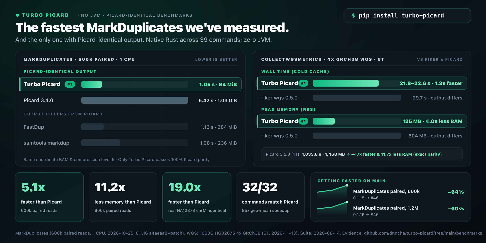

# Turbo Picard

[](https://github.com/dnncha/turbo-picard/actions/workflows/ci.yml)
[](https://pypi.org/project/turbo-picard/)
[](https://doi.org/10.5281/zenodo.20541927)

**Native Rust implementations of 35 Picard commands, plus 6 Turbo Picard utilities, with Picard-checked outputs, `KEY=VALUE` and GATK4 `--kebab-case` flags, and transparent fallback to upstream Picard for the remaining 86 commands.**

<a href="https://turbo-picard.readthedocs.io/en/latest/evidence/"><picture><source media="(max-width: 700px)" srcset="https://raw.githubusercontent.com/dnncha/turbo-picard/main/docs/site/assets/competitor-card-mobile.png"></picture></a>

[Documentation](https://turbo-picard.readthedocs.io/en/latest/) · [Command coverage](docs/commands.rst) · [Compare alternatives](https://turbo-picard.readthedocs.io/en/latest/compare/) · [Evaluate on your data](docs/real-data-evaluation.rst) · [Bunsen](https://bunsen.science)

---

## How fast is Turbo Picard?

Most bioinformatics pipelines pay a heavy tax in **JVM startup**, **Java heap bloat**, and **repeated BAM/CRAM decompression passes**. Turbo Picard removes the JVM on native paths, streams directly through HTSlib/libdeflate, uses bounded external sorting, and validates outputs against Picard 3.4.0 and 3.5.0 in CI.

**Bold** marks the #1 result in each benchmark group below.

### 1. Whole-genome QC vs Riker and Picard (`CollectWgsMetrics`)

1000 Genomes `HG02675` GRCh38 alignments · Intel i7-8700 · 6 threads (Picard 1T) · cold page cache ([`benchmarks/wgs-coverage-2026-11-13/README.md`](benchmarks/wgs-coverage-2026-11-13/README.md)):

| Depth | Tool | Wall time | Peak RSS | Advantage vs baseline / rival | Picard parity |
| :--- | :--- | ---: | ---: | ---: | :--- |
| **4x WGS** | **Turbo Picard** (6 workers) | **21.8–22.6 s** | **125 MB** | **~47x faster vs Picard · 1.3x faster & 4.0x less RAM vs Riker** | **✓ Exact** |
| 4x WGS | `riker wgs` 0.5.0 (6 threads) | 29.7 s | 504 MB | 35x faster vs Picard · 4.0x more RAM than Turbo Picard | ✗ Differs |
| 4x WGS | Picard 3.5.0 (1 thread) | 1,033.8 s | 1,468 MB | 1.0x reference · 11.7x more RAM than Turbo Picard | ✓ Reference |
| **15x WGS** | **Turbo Picard** (6 workers) | 65.4–82.6 s | **274 MB** | **Lowest RAM (~1.9x less than Riker)** | Not compared |
| 15x WGS | `riker wgs` 0.5.0 (6 threads) | 78.2–79.7 s | 518 MB | Competitive speed · ~1.9x more RAM | ✗ Differs |
| **30x WGS** | Turbo Picard *(pre-PR #76)* | 193.5 s | **412 MB** | **Lowest RAM (19% less than Riker)** | Not compared |
| 30x WGS | `riker wgs` 0.5.0 (6 threads) | **147.4 s** | 510 MB | Fastest pre-PR #76 (fallback to 1T on capped contig) | ✗ Differs |

- On the 4x genome Turbo Picard matches **every metric field and histogram row** of Picard 3.5.0 (the 15x and 30x genomes have no Picard output to compare); `riker wgs` uses simplified TSV output and documented metric differences.
- On 30x WGS pre-PR #76, hitting `LOCUS_ACCUMULATION_CAP=100,000` forced single-threaded whole-contig reprocessing; PR #76 replaced that with targeted capped-cluster reprocessing (awaiting i7-8700 rerun).
- On the 2.1 MB `gatk-na12878-mito` smoke check ([`bench_qc_vs_riker.md`](benchmarks/riker-comparison/evidence/bench_qc_vs_riker.md)): Turbo Picard ran `wgs-only` in **0.012 s** (`riker wgs` 0.024 s, **2.10x faster**; Picard 7.302 s, **634x faster**) and `wgs-bundle` in **0.025 s** (`riker multi` 0.053 s, **2.14x faster**; Picard 11.801 s, **477x faster**).

### 1b. 30x whole-genome comparison vs Picard 3.4.0 (`MarkDuplicates` & `CollectWgsMetrics`)

1000 Genomes `HG02675` (`ERR3242389`, 740,367,510 records, ~36x GRCh38 BAM) · 8 vCPU / 50 GB RAM · single run per tool ([`benchmarks/wgs-30x-colab-2026-11-23/README.md`](benchmarks/wgs-30x-colab-2026-11-23/README.md)):

| Command | Tool & build | Wall time | Peak RSS | Peak temp disk | Measured comparison vs Picard | Picard parity (measured scope) |
| :--- | :--- | ---: | ---: | ---: | :--- | :--- |
| **`MarkDuplicates`** | **Turbo Picard** `9a15db96` (Host A) | **59m 01s** | **355 MB** | 99.2 GB | **3.6x faster · 97x less RAM** · 4.3x more temp disk (#86) | Pre-#87: optical count & cols 1–11 differed |
| **`MarkDuplicates`** | **Turbo Picard** `93216217` (#87, Host B) | **43m 07s** | **354 MB** | not sampled | Different CPU host (AMD EPYC vs Intel Xeon) | **✓ Exact metrics & cols 1–11 MD5** (`PG` tag fixed in #88) |
| `MarkDuplicates` | Picard 3.4.0 (`-Xmx32g`, Host A) | 3h 30m 07s | 34.4 GB | **23.3 GB** | 1.0x reference | ✓ Reference |
| **`CollectWgsMetrics`** | **Turbo Picard** `9a15db96` (Host A) | **5m 08s** | **352 MB** | — | **26x faster · 11x less RAM** | **✓ Exact** (every metric & histogram row) |
| `CollectWgsMetrics` | Picard 3.4.0 (`-Xmx8g`, Host A) | 2h 13m 55s | 4.0 GB | — | 1.0x reference | ✓ Reference |

On Host A (`9a15db96`), duplicate-flagged counts matched (`79,289,617`), while `READ_PAIR_OPTICAL_DUPLICATES` (`5,631,099` vs `5,620,745`) and SAM columns 1–11 differed prior to #87. Build `93216217` (#87, run on Host B) matched Picard 3.4.0 exactly on metrics, duplicate count, and SAM columns 1–11 MD5 across all 740M records. After #88 (`@PG` chaining), `DT`, `DS`, `DI`, and `PG` tags matched Picard with zero differences on chr21 (`11,405,002` records); the whole genome has not been rerun on the #88 build. Turbo Picard also reads the `.crai`-indexed CRAM directly (`CollectWgsMetrics` 4m 53s / 689 MB, `MarkDuplicates` 41m 44s / 1.06 GB on Host A), whereas Picard 3.5.0 throws `CRAMException`.

### 2. Duplicate marking vs FastDup, `samtools markdup`, and Picard

Linux x86_64 · **1 pinned CPU** · BAM compression level 5 ([`benchmarks/markduplicates-competitors/`](benchmarks/markduplicates-competitors/README.md)):

| Dataset | Tool | Wall time | Peak RSS | Speedup vs Picard | RAM vs Picard | Picard parity |
| :--- | :--- | ---: | ---: | ---: | ---: | :--- |
| **`paired-600k`** | **Turbo Picard** | **1.054 s** | **94.1 MiB** | **5.15x** | **11.2x less** | **✓ Exact** |
| `paired-600k` | FastDup | 1.131 s | 383.8 MiB | 4.79x | 2.7x less | ✗ Differs |
| `paired-600k` | `samtools markdup` | 1.982 s | 235.7 MiB | 2.74x | 4.5x less | ✗ Differs |
| `paired-600k` | Picard 3.4.0 | 5.423 s | 1,052.6 MiB | 1.00x | 1.0x | ✓ Reference |
| **`gatk-na12878-mito`** | **Turbo Picard** | **0.141 s** | **9.5 MiB** | **19.0x** | **75.9x less** | **✓ Exact** |
| `gatk-na12878-mito` | FastDup | 0.201 s | 356.7 MiB | 13.3x | 2.0x less | ✗ Differs |
| `gatk-na12878-mito` | Picard 3.4.0 | 2.678 s | 721.3 MiB | 1.00x | 1.0x | ✓ Reference |

`samtools markdup` requires query-grouped `fixmate -m` and coordinate sorting, so its timer includes those preparation stages from a coordinate-sorted BAM. Only Turbo Picard matches Picard 3.4.0 on all flags, tags, metrics, and histograms.

### 3. Latest `main` core speedups (PR #76, Apple M5 vs prior `main` and Picard 3.4.0)

Paired warm-cache medians (1 warmup + 3 repeats) on Apple M5 comparing [`main`](https://github.com/dnncha/turbo-picard/pull/76) against pre-PR #76 `main` and Picard 3.4.0, as reported in the PR. The raw runs, input hashes and exact options were not retained, so treat these as indicative until a benchmark bundle is checked in:

| Command | Workload | Turbo Picard (`main`) | vs pre-PR #76 `main` | vs Picard 3.4.0 |
| :--- | :--- | ---: | ---: | ---: |
| **`MarkDuplicates`** | 1.2M paired BAM | **0.303 s / 73.8 MiB** | **2.07x faster** (37% less RSS) | **9.06x faster · 18x less RAM** |
| **`MarkDuplicates` (spill)** | 1.2M reads, bounded | **0.458 s** | **1.60x faster** | **4.21x faster** |
| **`SortSam` (coordinate)** | 1.2M reads | **0.520 s** | **2.35x faster** | **4.32x faster** |
| **`SortSam` (queryname)** | 1.2M reads | **0.415 s** | **2.64x faster** | **4.63x faster** |
| **`MergeSamFiles` (4-way)** | 1.2M reads | **0.166 s** | **1.74x faster** | **6.58x faster** (`samtools -@8`: 0.154 s) |
| **`CollectHsMetrics`** | Capture panel intervals | **0.546 s** | **1.24x faster** | **12.8x faster** |
| **`SamToFastq`** | 600k paired BAM | **0.577 s** | **1.71x faster** | **1.92x faster** |
| **`CleanSam`** | 600k paired BAM | **0.077 s** | **1.40x faster** | **9.44x faster** |

---

## Quick Start

Install from PyPI (Linux x86_64, macOS Intel & Apple Silicon, or source build):

```bash
python3 -m pip install turbo-picard==0.1.21
```

Or run the container:

```bash
docker run --rm ghcr.io/dnncha/turbo-picard:0.1.21 --version
```

Or build from source:

```bash
cargo install --locked --path crates/turbo-picard-cli --bin turbo-picard --bin picard
```

### Keep upstream Picard as automatic fallback

`turbo-picard` runs natively when a command and its options fall inside its documented native scope (**41 commands**: 12 full-scope, 29 scoped-native), and forwards the remaining **86 commands** (or unsupported flags) to upstream Picard when configured:

```bash
mamba create -n turbo-picard -c conda-forge -c bioconda \
  turbo-picard picard=3.4.0 openjdk
mamba activate turbo-picard
turbo-picard doctor
```

With a `pip` install, set `PICARD_JAR=/path/to/picard.jar` with Java on `PATH`. See [fallback behavior](docs/fallback.rst).

Installing from PyPI currently gives you both commands:

- `turbo-picard` — explicit binary for evaluation and targeted pipeline steps.
- `picard` — optional compatibility shim when you want existing `picard` calls to resolve to Turbo Picard.

Use the explicit `turbo-picard` command while testing. Switch a pipeline task only after verifying outputs on a representative input:

```bash
# Check environment and fallback readiness
turbo-picard doctor

# Print the exact side-by-side comparison contract before editing a workflow
turbo-picard trial MarkDuplicates I=input.bam O=marked.bam M=metrics.txt

# Enforce native execution (fail instead of delegating to Java)
TURBO_PICARD_REQUIRE_NATIVE=1 turbo-picard MarkDuplicates \
  I=input.bam O=marked.bam M=metrics.txt
```

### Machine-readable discovery and MCP server

For Nextflow/WDL/Snakemake generators and coding agents, inspect command support, generate trial contracts, or run isolated native-vs-Picard parity verification over MCP stdio (`capabilities`, `explain`, `trial`, `doctor`, `run`, `verify`):

```bash
turbo-picard capabilities --json --command MarkDuplicates
turbo-picard explain --json SortSam I=in.bam O=out.bam SORT_ORDER=coordinate
claude mcp add turbo-picard -- turbo-picard mcp
```

`mcp-name: io.github.dnncha/turbo-picard`. Agent integrations for Claude Code (`/plugin install turbo-picard --marketplace dnncha/turbo-picard`), Codex, and Cursor live in [`packaging/agents/`](packaging/agents/README.md). Both classic Picard `KEY=VALUE` arguments and GATK4 `--kebab-case` / bare boolean flags (`--create-index`, `--remove-duplicates`, `-AS`) are accepted.

---

## When It Helps

- You run `MarkDuplicates`, `SortSam`, `MergeSamFiles`, `SamToFastq`, `FastqToSam`, `FixMateInformation`, `BuildBamIndex`, `CollectWgsMetrics`, `CollectHsMetrics`, `CollectRnaSeqMetrics`, `CollectSamErrorMetrics`, `CollectMultipleMetrics`, or VCF utilities and want lower wall time and memory without rewriting pipeline syntax.
- You need Picard-style command names, `KEY=VALUE` flags, and Picard-checked outputs (flags, tags, metrics text, histograms, indexes, MD5 sidecars) to stay intact.
- You want a one-command-at-a-time rollout where unsupported commands or flags cleanly fall back to upstream Picard.
- You want to compare outputs side by side on your own BAM/CRAM with [`tools/compare_real_data.py`](docs/real-data-evaluation.rst) before changing anything in a shared pipeline.

## When To Stay With Picard

- You need a command or option outside the documented native scope and cannot configure upstream Picard fallback.
- You require Picard's full R-rendered chart PDFs rather than checked metrics text (`CollectBaseDistributionByCycle`, `CollectGcBiasMetrics`, `CollectInsertSizeMetrics`, `MeanQualityByCycle`, `QualityScoreDistribution` emit lightweight PDF summaries).
- You have not verified required flags, sidecars, metrics, exit codes, and downstream tools on a representative shard of your own data.

## Documentation & Workflow Integration

The full docs are on Read the Docs: [turbo-picard.readthedocs.io](https://turbo-picard.readthedocs.io/en/latest/).

- **Start here:** [Quickstart](https://turbo-picard.readthedocs.io/en/latest/quickstart.html) · [Command coverage matrix](docs/commands.rst) · [Choose your first command](https://turbo-picard.readthedocs.io/en/latest/first-command.html)
- **Compare & switch safely:** [Turbo Picard vs Riker](https://turbo-picard.readthedocs.io/en/latest/turbo-picard-vs-riker.html) · [Picard alternatives](https://turbo-picard.readthedocs.io/en/latest/picard-alternatives.html) · [Parity guide](https://turbo-picard.readthedocs.io/en/latest/parity.html) · [Trying it in a pipeline](https://turbo-picard.readthedocs.io/en/latest/adoption.html) · [Evaluation playbook](https://turbo-picard.readthedocs.io/en/latest/evaluation-playbook.html)
- **Reference & verification:** [Benchmarks](https://turbo-picard.readthedocs.io/en/latest/benchmarks.html) · [Performance architecture](docs/performance.rst) · [Fallback behavior](docs/fallback.rst) · [Packaging](https://turbo-picard.readthedocs.io/en/latest/packaging.html) · [Citation](https://turbo-picard.readthedocs.io/en/latest/citation.html) · [Troubleshooting](https://turbo-picard.readthedocs.io/en/latest/troubleshooting.html)
- **Pipeline starters:** WDL, Nextflow, Snakemake, and shell templates live in [`packaging/workflows/`](packaging/workflows/) (minimal trial: [`one-command-trial.md`](packaging/workflows/one-command-trial.md)), plus the nf-core process candidate in [`packaging/nf-core/`](packaging/nf-core/README.md). Migration patterns that preserve surrounding steps include per-read-group `SamToFastq`, sequential-shard `FastqToSam`, and mate-repair boundaries around `FixMateInformation`.

Run your own side-by-side comparison using the repository evaluator (local execution only, separate output directory, retains failed runs for inspection): see the [real-data evaluation guide](docs/real-data-evaluation.rst) or share redacted trial reports via the [trial report issue form](https://github.com/dnncha/turbo-picard/issues/new?template=trial-report.yml) (or [thread #4](https://github.com/dnncha/turbo-picard/issues/4)). See the [workflow validation protocol](docs/production-readiness.rst), [compatibility contract](docs/compatibility-contract.rst), and [production-scale benchmark format](benchmarks/production/README.md).

---

## Saved 32-Command Small-Fixture Suite & Evidence Gates

Across the 32 parity-checked commands in the saved small-fixture suite (where JVM startup contributes materially and does not by itself predict whole-genome ratios), Turbo Picard records a **22.88x** minimum, **84.52x** geometric mean, **99.51x** median, and **272.12x** maximum speedup against Picard 3.4.0. In the saved `MarkDuplicates` fixture (`reads=50000`), median wall times were **0.075464 seconds** for Turbo Picard vs **2.238986 seconds** for Picard. See the [benchmark guide](docs/benchmarks.rst) and [parity guide](docs/parity.rst). Metrics-text agreement does not establish Picard-equivalent charts; [Bunsen](https://bunsen.science/) publishes broader software investigations and corrections.

### Saved benchmark record

<details>
<summary>Expand all 32 small-fixture measurements, exemptions, provenance, and verification commands</summary>

The saved public benchmark suite compares native `turbo-picard` commands against Picard 3.4.0 and checks stable outputs before reporting speed. Current saved results report `32/32` parity checks passing, with `272.12x` top speedup: `NormalizeFasta`, `22.88x` floor speedup: `SetNmMdAndUqTags`, `99.51x` median speedup, and `84.52x` geometric mean speedup.

Summary: `32/32 PASS`; `272.12x` top speedup: `NormalizeFasta`; `22.88x` floor speedup: `SetNmMdAndUqTags`; `99.51x` median speedup; `84.52x` geometric mean speedup.

Benchmark details, scope notes, real-data evidence, and reproduction commands are in the [benchmark docs](https://turbo-picard.readthedocs.io/en/latest/benchmarks.html). The [parity guide](https://turbo-picard.readthedocs.io/en/latest/parity.html) explains what the comparisons do and do not prove. For `CollectBaseDistributionByCycle`, `CollectGcBiasMetrics`, `CollectInsertSizeMetrics`, `MeanQualityByCycle`, and `QualityScoreDistribution`, metrics text is the parity target; chart outputs are lightweight PDF summaries, not Picard-equivalent rendered plots.

Saved benchmark run:

- Date: `2026-08-14`
- Command: `python3 tools/bench_suite.py --repeats 3 --skip-build`
- Raw log: `docs/site/assets/bench-suite-output.txt`
- benchmark exceptions: `AccelerationStatus`, `capabilities`, `doctor`, `explain`, `mcp`, and `trial` are utility commands, not Picard workload comparisons. `CollectHsMetrics`, `CollectRnaSeqMetrics`, and `CollectSamErrorMetrics` have separate Picard parity coverage; suite-integrated small-fixture entries await representative capture/transcript/error fixtures in the automated suite.

| Command | Speedup | Parity |
| --- | ---: | :--- |
| NormalizeFasta | 272.12x | PASS |
| BuildBamIndex | 243.53x | PASS |
| UpdateVcfSequenceDictionary | 207.52x | PASS |
| CollectGcBiasMetrics | 196.45x | PASS |
| CreateSequenceDictionary | 152.62x | PASS |
| GatherVcfs | 130.70x | PASS |
| LiftoverVcf | 127.28x | PASS |
| CollectMultipleMetrics | 122.66x | PASS |
| CollectInsertSizeMetrics | 117.34x | PASS |
| CleanSam | 115.42x | PASS |
| MergeVcfs | 112.13x | PASS |
| MeanQualityByCycle | 108.66x | PASS |
| CollectQualityYieldMetrics | 108.64x | PASS |
| QualityScoreDistribution | 107.17x | PASS |
| ReplaceSamHeader | 101.84x | PASS |
| ValidateSamFile | 99.56x | PASS |
| IntervalListTools | 99.46x | PASS |
| CollectBaseDistributionByCycle | 98.01x | PASS |
| SortVcf | 89.01x | PASS |
| CollectAlignmentSummaryMetrics | 83.49x | PASS |
| BedToIntervalList | 79.78x | PASS |
| ViewSam | 79.58x | PASS |
| AddOrReplaceReadGroups | 77.78x | PASS |
| SamToFastq | 77.74x | PASS |
| CollectWgsMetrics | 50.81x | PASS |
| MergeSamFiles | 35.49x | PASS |
| SortSam | 35.15x | PASS |
| FixMateInformation | 31.98x | PASS |
| FastqToSam | 31.29x | PASS |
| MarkDuplicates | 28.70x | PASS |
| RevertSam | 24.19x | PASS |
| SetNmMdAndUqTags | 22.88x | PASS |

Release evidence checks:

```bash
python3 tools/update_real_data_manifest.py
python3 tools/verify_benchmark_log_evidence.py
python3 tools/verify_benchmark_suite_coverage.py
python3 tools/verify_benchmark_thresholds.py
python3 tools/verify_real_data_evidence.py
python3 tools/verify_real_data_evidence.py --release-ready
```

Real-data evidence lives in `benchmarks/real-data/` and records pinned input sources, command scopes, and input SHA-256 hashes. Current release-candidate dataset IDs are `gatk-na12878-mito`, `picard-snvq`, and `gatk-na12878-mito-cram`.

</details>

---

## Packaging Status & Citation

- **Release:** The current source release is `0.1.21` on [GitHub Releases](https://github.com/dnncha/turbo-picard/releases/tag/v0.1.21) and [PyPI](https://pypi.org/project/turbo-picard/0.1.21/) (Linux x86_64, macOS Intel & Apple Silicon wheels, plus sdist for Linux ARM64 with a Rust toolchain). See [`CHANGELOG.md`](CHANGELOG.md) for release notes and [`website/assets/distribution-status.json`](website/assets/distribution-status.json) for observed build checksums.
- **Bioconda:** Accepted [initial recipes](https://github.com/bioconda/bioconda-recipes/pull/65922) on 4 October 2026 (`0.1.15` in Bioconda indexes on 25 October; [0.1.16 main](https://github.com/bioconda/bioconda-recipes/pull/69890) and [shim](https://github.com/bioconda/bioconda-recipes/pull/69891) updates open upstream). [`turbo-picard-full`](packaging/bioconda/turbo-picard-full/README.md) documents the combined `turbo-picard + picard + openjdk` recipe.
- **Citation:** Cite the archived `turbo-picard` release you used via [`CITATION.cff`](CITATION.cff) (DOI `10.5281/zenodo.20541927`). Cite benchmark and validation inputs separately with immutable source URLs, commits or accessions, and input SHA-256 hashes. Docs live in [`docs/`](docs/); JOSS submission notes are in [`docs/joss-submission.rst`](docs/joss-submission.rst).

## Contributing

Bug reports, parity evidence, documentation fixes, and command-coverage contributions are welcome. See [`CONTRIBUTING.md`](CONTRIBUTING.md), the [development docs](https://turbo-picard.readthedocs.io/en/latest/development.html), [`SUPPORT.md`](SUPPORT.md), and [`SECURITY.md`](SECURITY.md).
